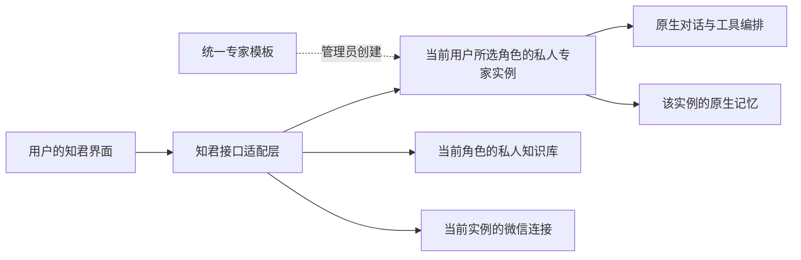

# 知君局域网测试版设计

## 产品结构

知君是一个具有固定能力的个人对话产品。用户只关心与知君相处、修正知君的理解、管理自己的资料。底座的专家、模型、工具、运行配置不成为产品导航。

| 入口 | 内容 | 用户可以配置 |
| --- | --- | --- |
| 对话 | 当前对话、历史、流式回复、必要的操作确认 | 对话名称 |
| 记忆 | 关于自己的有效记忆、原句来源、修正和撤回 | 记忆内容 |
| 知识库 | 资料集、文件、处理状态和阅读 | 资料集是否用于对话 |
| 设置 | 账户、记忆整理、知识库说明、微信、阅读 | 对应的个人设置 |

对话是默认首页。保留知君的纸白、深墨、朱红和宋体标题，减少卡片、统计与管理术语。没有资料时呈现真实空状态，没有实例时显示待开通，网络不可达时给出连接提示。

## 调用链

适配层只负责登录会话、角色与实例绑定、请求白名单、归属检查与原生协议转发。它不调用模型，不拼接系统提示，不重新实现推理、提取、检索或微信通道。

## 数据边界的代码依据

依据：`centaur-WANX-github-octop`，提交 `3e0034ce2122e2e4bb1055b87cfed302c42ec71b`。

- `src/octop/api/common/agent.py`：共享实例可被其他用户访问，但 owner 接口要求所有者/管理员。
- `src/octop/api/common/memory_client.py`：记忆命名空间是 `agent_<agent_id>`，调用记忆 RPC 前执行 owner 检查。
- `src/octop/api/routers/memory.py`：原子记忆操作与提取设置使用实例记忆。
- `src/octop/api/routers/chat/turn.py`：会话归属于 agent 与 user；在后台检查。
- `src/octop/api/routers/knowledge_bases.py`：原生知识库有 owner 与 shared 属性。
- `src/octop/api/routers/channels.py`：微信配置归属于实例，原生 WANX 扫码结果需要保存为通道配置。

因此本方案共享模板能力，不共享同一个有记忆的运行实例。原生 `application_id=zhijun` 的账户隔离是另一套现有业务逻辑；此测试版不伪造该身份，不使用旧 `/api/zhijun/*` 个性化业务。

## 固定能力与账户权限

客户端发送的内容只包含用户文本、当前会话。接口层根据当前账户的服务端角色绑定锁定私人实例，并显式提交该角色开启的私人知识库；不能通过前端参数切换专家、模型、技能、系统消息或审批策略。

用户自己的后台账户权限仍是原生服务的最终权限边界。产品接口做功能收敛不等于整个后台账户成为全局 capability-scoped 凭据；如需发行给不应访问原后台的第三方用户，应在服务端增加真正的客户端范围授权。

## 本次交付边界

本次交付是可运行的独立 Web 测试客户端和接口适配层。未修改现有后台、旧知君、模型设置、账户或任何已有记忆。能力来源现已指定为共享专家“知君”，为 test 配置首次登录创建私人实例；开通后仍需真实业务验证。没有以假数据或固定回答冒充原生服务结果。

## 个人角色（2026-10-10）

同一账户可以创建多个个人角色，填写名称和定位。角色沿用部署配置中统一的知君能力规则与模型，每个角色拥有独立的 WANX agent、工作区、原生记忆、会话和私人知识库。角色定位写入新实例的 AGENTS.md。创建时不复制任何原实例的记忆、资料或对话。当前实现使用创建时的能力配置快照；以后修改模板不会自动同步已创建的角色。

已有绑定显示为“个人”，原实例与知识库不迁移、不清空。新角色绑定保存在服务端 `.runtime/roles/roles.json`，目录权限 0700、文件权限 0600，随部署数据一起备份。角色名称和定位由用户填写，实例 ID、知识库 ID 和工作区由服务端生成。未完成的创建不会成为可选角色，重复请求可以恢复创建。

每个 HTTP 请求携带角色选择，服务端仅接受当前账户已绑定的角色，并重新检查实例归属；WebSocket 在建立时固定角色。不同浏览器标签页互不修改对方的选择。切换角色会取消旧请求、关闭旧对话连接并重建记忆与知识库视图；旧角色已在后台执行的任务不会因此保证取消。知识库访问也检查角色绑定，不能通过修改 ID 读取同账户其他角色的资料。

此处为知君入口及原生实例命名空间的隔离，不增加新的操作系统沙箱，也不收窄用户原有 WANX 账户权限。当前提供创建、定位和切换，尚未提供角色重命名、重新定义或删除入口。

## 记忆界面（2026-10-10）

原生九个记忆视图保留，导航按“认识自己 / 回看来处 / 相处方式”分组。使用纸白、深墨、朱红与细分隔线统一界面；设置采用并列选项和单一页面滚动。修改、来源、确认和撤回仍调用原生接口，不引入第二份记忆数据。

## 界面整合（2026-10-10）

角色切换固定在侧栏底部、头像上方；头像与“私人空间”是账户设置入口。设置采用分类导航与内容面板，账户、阅读偏好与当前角色的记忆、知识库、微信设置明确区分。手机端保留紧凑角色入口、头像和新对话按钮，设置分类横向滚动。

未登录时显示独立山水登录页，使用既有 `src/assets/zhijun-login-companion.png` 原图，素材来源见同目录 `LOGIN_ARTWORK.md`。会话检查期间不显示登录表单，网络错误提供重试。继续沿用原生账户、验证码和角色请求隔离机制。记忆设置通过可选 hideHeader 参数嵌入，复用原生配置与保存逻辑。
